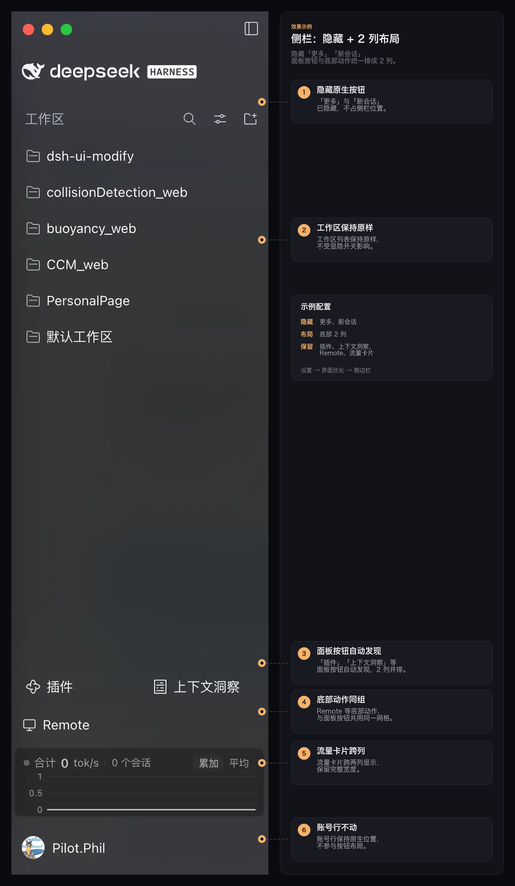

# dsh-ui-modify

针对 DeepSeek Harness Web 界面的小改动合集。所有改动都从「设置 → 界面优化」里的分类页面控制；侧栏按钮组末尾还有一行内联的折叠/展开控制。偏好保存在当前 profile 的插件配置中。

## 结构

设置页按**界面区域**分类，方便以后增加其他区域的优化：

- **侧边栏**
  - **按钮可见性**：自动发现侧栏上的所有按钮，逐个控制显示/隐藏；
  - **按钮布局**：把侧栏按钮统一排成 2 列网格（顶部/底部/保持原样）；
  - **按钮区折叠**：用一行「折叠按钮区」把整组按钮收起，只留下展开按钮。
- **其他区域**：预留，后续针对主界面、对话等区域的优化会显示在这里。

## 效果示例



示例配置：隐藏「更多」「新会话」，按钮布局选「底部 2 列」。图中标注：

1. 原生「更多」「新会话」已隐藏，不占侧栏位置；
2. 工作区列表保持原样，不受显隐开关影响；
3. 「插件」「上下文洞察」等面板按钮自动发现，并按 2 列排列；
4. `Remote` 等底部动作纳入同一按钮组；
5. 流量卡片跨两列显示，保留完整宽度；
6. 账号行保持原生位置，不参与按钮布局。

> 面板按钮下方、底部动作上方还有一行「折叠按钮区」，用于收起整组按钮；示例图截于该控件加入前，所以图中没有这一行，效果见下文「按钮区折叠」。
>
> 隐藏项只是不显示，不会卸载；在「设置 → 界面优化 → 侧边栏 → 按钮可见性」里随时恢复。

## 侧边栏

### 按钮可见性（自动发现）

列表由三部分组成：

1. **原生控件**
   - 「更多」按钮：仅在 `sidebar.panellist.actions` 有注册项（官方侧栏会因此渲染该按钮）时出现；
   - 「新会话」按钮：官方侧栏顶部的原生按钮。
2. **面板按钮**：读取 `sidebar.panellist` 的注册项，例如「插件」「上下文洞察」「自动化任务」。
3. **底部动作**：读取 `sidebar.footer.action` 的注册项，例如 `Remote`、流量卡片。

列表随插件启用/禁用和界面语言变化自动更新。每一项一个开关；隐藏方式：

- **原生控件**：注入作用域很窄的样式规则（更多按钮只匹配左侧栏面板列表里的菜单按钮；新会话按钮只匹配侧栏里的 `newSession` 按钮）。
- **面板按钮**：用同一个 id、更低 `priority` 注册一个“影子”图标（slot 注册表本身支持最低优先级遮蔽），影子只渲染一个标记，再由一条 CSS 规则隐藏整行。面板本身仍可通过「更多」菜单等方式打开。
- **底部动作**：同样用更低 priority 的影子注册，但组件返回 `null`，原组件不再挂载；重新打开后原注册自动恢复。

底部动作多数没有注册 `label`，列表中会回退显示插件 id（如 `ds-harness-remote`、`dsh-flowmeter`）。插件卸载或某项消失时，列表和影子注册会自动清理；配置中残留的键在条目重新出现时继续生效。

### 按钮布局

不同插件把按钮放在不同位置：面板按钮在顶部，`Remote` 等底部动作在最底部。选择布局模式后，本插件用 `display: contents` + flex `order` 把两个容器放到一起，并分别设为相同的 2 列 grid：

- **顶部 2 列**：按钮组排在工作区列表上方；
- **底部 2 列**：按钮组排在工作区列表下方、账号与设置行上方；
- **保持原样**：不注入任何布局规则。

只在侧栏展开态生效，收起的窄轨道保持原样。流量卡片属于底部动作区，会随按钮组一起移动；账号与设置行始终保留在最底部。

### 按钮区折叠

面板按钮下方、底部动作上方有一行很薄的「折叠按钮区」控制条，点击后收起：

- **收起的面板按钮**：`插件`、`上下文洞察` 等，以及面板列表里的「更多」；
- **收起的底部动作**：`Remote`、流量卡片等；
- **保留的展开条**：一行「展开按钮区」，随时可以点开；
- **不受影响**：工作区列表、账号与设置行、`新会话` 按钮（如需隐藏请在「按钮可见性」里单独关闭）。

折叠状态保存在 Host 配置 `sidebarButtonsCollapsed` 中，重启/换窗口保持；设置页的「按钮布局 → 折叠按钮区」开关与侧栏里的折叠条双向同步。折叠控制在所有布局模式下都生效。

折叠条本身不会出现在「按钮可见性」列表里，避免用户把它藏掉后无法展开；它也不属于影子隐藏机制，始终挂载在底部动作区。

## 偏好存储

| 字段 | 默认值 | 含义 |
| --- | --- | --- |
| `hiddenSidebarItems` | `[]` | 统一列表中隐藏的条目，键形如 `native:more`、`panellist:plugins`、`footer:<id>` |
| `sidebarButtonLayout` | `default` | `default` / `top` / `bottom`：侧栏按钮排列 |
| `sidebarButtonsCollapsed` | `false` | 是否把面板按钮与底部动作折叠成一行展开条 |
| `showSidebarMore` | `true` | **兼容旧版**：等价于隐藏 `native:more` |
| `showScheduledTasks` | `true` | **兼容旧版**：等价于隐藏 `panellist:schedules` |
| `showNewSession` | `true` | **兼容旧版**：等价于隐藏 `native:newSession` |

- 字段都声明为 `volatile`，修改后立即生效，不会重启插件；
- 配置由 DSH 的设置编辑器持久化到当前 profile 的补丁层，重启应用、换浏览器都不会丢失；
- 浏览器端通过 `ctx.configForms` 读取同一份配置，多个窗口保持一致；
- 旧版三个布尔字段仍被读取；在统一列表里重新打开对应项时会自动把它们清回 `true`。

Host 半在 `index.js` 中声明 `Config`，并用 `settings.configure({ auto: false })` 表明本插件自带设置页，避免插件管理器再生成一份配置表单。

## 实现

| 文件 | 作用 |
| --- | --- |
| `index.js` | Host 半：`Config`（布局枚举、隐藏条目数组、折叠状态、旧版兼容字段）与设置呈现策略。 |
| `client.js` | Client 半：分类设置页、配置表单订阅、按钮发现、影子注册、布局 / 隐藏 / 折叠样式与折叠控制条。 |
| `cordis.patch.yml` | 插入 Host 行 `dsh-ui-modify`。 |
| `locale/*.json` | 插件在插件管理器中的标题与描述。 |
| `icon.svg` | 插件图标。 |

所有资源（样式标签、slot 注册、订阅）都挂在插件自己的 `ctx.effect` / `ctx.slots.inject` 上，卸载插件时一并移除。

## 安装

在 DSH 的当前 profile 中安装本目录：

```
plugin_manager install_bundle <本目录绝对路径>
```

Host 半依赖 `@deepseek-ai/schemastery`（已写入 `dependencies`），在目录内执行 `npm install` 即可。
安装后可在「设置 → 界面优化 → 侧边栏」看到自动发现的按钮列表与布局选项。
